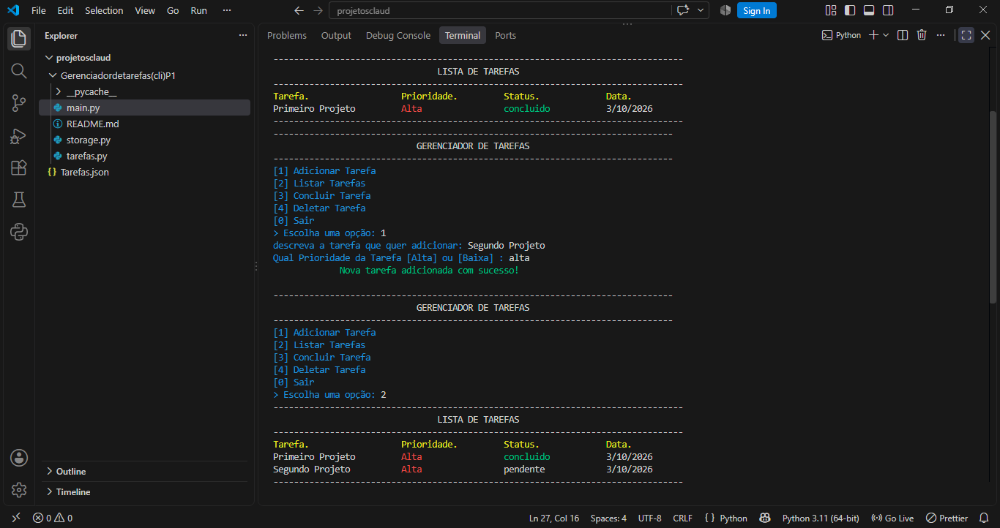

# 📋 Gerenciador de Tarefas CLI

Aplicação de linha de comando (CLI) para gerenciar tarefas do dia a dia, desenvolvida em Python puro. Permite adicionar, listar, concluir e deletar tarefas, com persistência de dados em arquivo JSON.

---

## 🖥️ Demonstração


```
--------------------------------------------------------------------
                    GERENCIADOR DE TAREFAS                    
--------------------------------------------------------------------
[1] Adicionar Tarefa
[2] Listar Tarefas
[3] Concluir Tarefa
[4] Deletar Tarefa
[0] Sair
> Escolha uma opção:
```

---

## ✅ Funcionalidades

- Adicionar tarefa com descrição, prioridade (Alta/Baixa) e data de criação automática
- Listar todas as tarefas em formato de tabela com cores no terminal
- Concluir tarefa pelo número
- Deletar tarefa pelo número
- Persistência de dados em arquivo `Tarefas.json` — os dados continuam salvos após fechar o programa
- Tratamento de erros de entrada (valores inválidos, Ctrl+C, JSON corrompido)

---

## 🚀 Como rodar

**Pré-requisitos:** Python 3.x instalado

```bash
# Clone o repositório
git clone https://github.com/seu-usuario/gerenciador-tarefas-cli.git

# Entre na pasta
cd gerenciador-tarefas-cli

# Execute o programa
python main.py
```

Nenhuma biblioteca externa necessária — o projeto usa apenas a biblioteca padrão do Python.

---

## 🗂️ Estrutura do projeto

```
gerenciador-tarefas-cli/
│
├── main.py        # Ponto de entrada — menu principal e fluxo do programa
├── tarefas.py     # Lógica das operações (adicionar, listar, concluir, deletar)
├── storage.py     # Leitura e escrita do arquivo JSON + funções utilitárias
├── Tarefas.json   # Arquivo de dados gerado automaticamente na primeira execução
└── README.md
```

---

## 🛠️ Tecnologias e módulos utilizados

| Módulo | Uso |
|--------|-----|
| `json` | Serialização e leitura dos dados persistidos |
| `pathlib` | Verificação e manipulação de caminho do arquivo |
| `datetime` | Registro automático da data de criação da tarefa |
| `time` | Pausa entre ações no menu para melhor experiência |
| `re` | Remoção de códigos ANSI para alinhamento correto da tabela colorida |

---

## 📚 O que aprendi com este projeto

Este foi o meu primeiro projeto Python completo, desenvolvido em 4 dias.

O maior desafio foi a **manipulação de arquivos JSON**: não sabia como ler, gravar e atualizar dados persistidos em arquivo. Precisei pesquisar, entender o módulo `json`, testar bastante e resolver erros até o código funcionar corretamente.

Outros conceitos praticados:
- Separação de responsabilidades em módulos (`main`, `tarefas`, `storage`)
- Tratamento de exceções específicas (`json.JSONDecodeError`, `IOError`, `TypeError`, `ValueError`, `KeyboardInterrupt`)
- Manipulação de listas e dicionários
- Cores no terminal com códigos ANSI
- Resolução de um problema real: o alinhamento de texto quebraba por causa dos códigos de cor invisíveis — criei as funções `len_sem_cor` e `alinhar_celula` para calcular o tamanho real do texto sem os caracteres de escape

---

## 🔮 Melhorias futuras

- [ ] Filtrar tarefas por prioridade ou status
- [ ] Editar descrição de uma tarefa existente
- [ ] Armazenar cores separadas do dado no JSON
- [ ] Interface gráfica com `tkinter`

---

*Projeto #01 do meu roadmap de aprendizado em Python — [ver roadmap completo](https://github.com/seu-usuario)*
